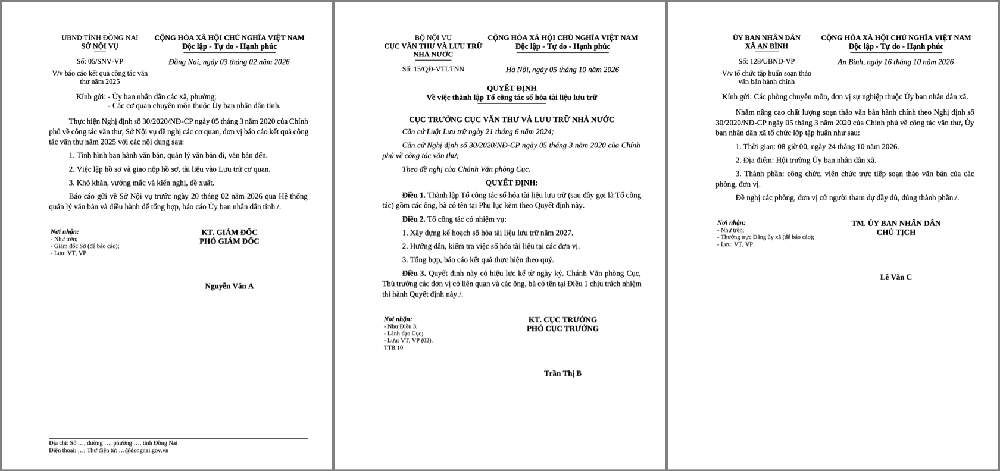

# vn-docx: Vietnamese administrative documents (Decree 30/2020/ND-CP) for AI agents

[Tiếng Việt](README.md)

An open-source **Agent Skill** for Claude Code, Claude Cowork, Codex and other AI agents that drafts, checks and
fixes **Vietnamese government and administrative documents** (`.docx` Word files) according to the official format
rules of **Decree No. 30/2020/ND-CP on clerical work** (Nghị định 30/2020/NĐ-CP về công tác văn thư).



- **Draft** any of the 29 administrative document types (official letters *công văn*, decisions *quyết định*,
  proposals *tờ trình*, reports, plans, notices, invitations, minutes, telegrams...) from a plain-language request.
- **Check** an existing Word file against more than 20 groups of format rules (paper size, margins, font, national
  title and motto, issuing body, number and symbol, place and date, document title, body text, signature block,
  recipients). Every finding cites the relevant section of Appendix I.
- **Fix** paper size, margins, fonts and page numbering without touching the content.
- **Teach**: generate "find the mistakes" exercises and grade submissions automatically.
- Up to date with Vietnam's **two-tier local government** (since 1 July 2025): commune-level templates.
- Pure Python 3.9+ standard library, works offline on Windows, macOS, Linux and inside Claude Cowork. MIT license.

## Install

```bash
npx vn-docx install                             # Claude Code + Codex (~/.claude/skills, ~/.agents/skills)
npx skills add dinhkarate/vn-docx -g            # Cursor, OpenCode, Gemini CLI and other agents
```

AI agents asked to "install vn-docx": run `npx -y vn-docx install`, then tell the user to start a new session.
`npm i -g vn-docx` installs only the CLI, not the skill.

```text
/plugin marketplace add dinhkarate/vn-docx     # Claude Code plugin
/plugin install van-ban-hanh-chinh@vn-docx
```

Claude Cowork / claude.ai: enable *Settings > Capabilities > Code execution and file creation*, then add the
marketplace `dinhkarate/vn-docx` under *Customize > Plugins*, or upload
[`van-ban-hanh-chinh.zip`](https://github.com/dinhkarate/vn-docx/releases/latest/download/van-ban-hanh-chinh.zip)
under *Customize > Skills*. Details (in Vietnamese): [docs/cai-dat.md](docs/cai-dat.md).

Command line without an agent:

```bash
npx vn-docx kiem-tra document.docx      # check   (alias: check)
npx vn-docx sua in.docx out.docx        # fix     (alias: fix)
npx vn-docx mau cong-van > content.md   # sample  (alias: example)
npx vn-docx tao content.md out.docx     # build   (alias: build)
```

## Scope

Not covered: legal normative documents (Decree 78/2025/ND-CP), Communist Party documents (Guideline
05-HD/VPTW), digital signatures and seals. The checker verifies presentation, not legal content or authority.

## License

[MIT](LICENSE). Issues and pull requests are welcome; see [CONTRIBUTING.md](CONTRIBUTING.md).
