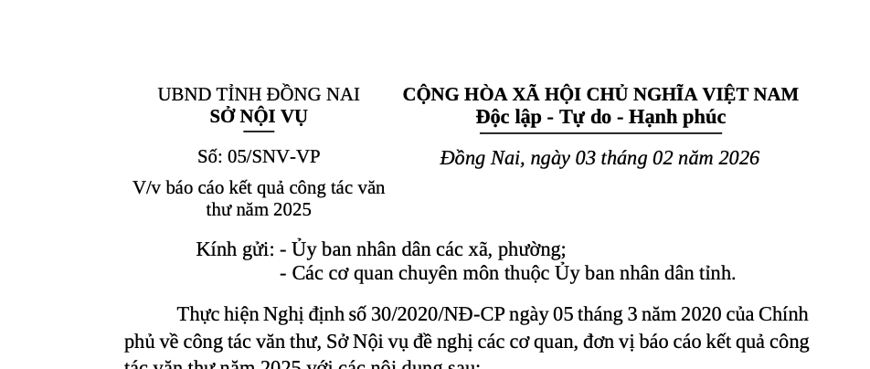

# vn-docx: soạn văn bản hành chính đúng Nghị định 30 bằng AI

[](https://github.com/dinhkarate/vn-docx/actions/workflows/test.yml)
[](https://www.npmjs.com/package/vn-docx)
[](LICENSE)

[English](README.en.md)

Skill mã nguồn mở cho **Claude Code, Claude Cowork, Codex** và các AI agent khác: nói bằng lời, nhận về file
Word `.docx` trình bày đúng **thể thức Nghị định 30/2020/NĐ-CP** về công tác văn thư. Kiểm tra và sửa lỗi
thể thức file Word có sẵn. Có bài tập "tìm lỗi" cho lớp học.


> *"Soạn công văn của UBND xã An Bình mời các phòng dự tập huấn soạn thảo văn bản ngày 24/10, người ký Chủ tịch
> Lê Văn C."*
>
> Agent hỏi thêm nếu thiếu, viết nội dung, dựng file `.docx`, tự kiểm tra hơn 20 nhóm tiêu chí thể thức rồi báo lại những
> chỗ còn để trống (số văn bản, ngày ký).

## Cài đặt

**Claude Code, Codex (dòng lệnh hoặc desktop)**: nói với agent *"cài vn-docx"*, hoặc tự chạy

```bash
npx vn-docx cai-dat      # hoặc: npx vn-docx install
```

Lệnh chép skill vào `~/.claude/skills` (Claude Code) và `~/.agents/skills` (Codex, các agent khác); chạy lại để
cập nhật. Mở phiên mới của agent để dùng.

**Cursor, Antigravity, OpenCode, Gemini CLI và các agent khác**: `npx skills add dinhkarate/vn-docx -g`

**Claude Code (plugin)**

```text
/plugin marketplace add dinhkarate/vn-docx
/plugin install vn-docx@vn-docx
```

**Claude Cowork, claude.ai**: bật *Settings > Capabilities > Code execution and file creation*, rồi

- *Customize > Plugins > Add > Add marketplace > Add from a repository*, nhập `dinhkarate/vn-docx`; hoặc
- tải [`vn-docx.zip`](https://github.com/dinhkarate/vn-docx/releases/latest/download/vn-docx.zip),
  vào *Customize > Skills > + > Upload a skill*.

**Không dùng AI**: `npx vn-docx kiem-tra van-ban.docx`

> Dành cho AI agent được nhờ "cài vn-docx": chạy `npx -y vn-docx install`, rồi báo người dùng mở phiên mới.
> `npm i -g vn-docx` chỉ cài công cụ dòng lệnh, không cài skill.

**Gọi skill**: mở phiên mới rồi nói việc cần làm (*"soạn công văn..."*, *"kiểm tra file này đúng Nghị định 30
chưa"*), agent tự dùng skill. Gọi đích danh: `/vn-docx` (Claude Code), `$vn-docx` (Codex).

Chi tiết từng môi trường, cài cho cả lớp, xử lý sự cố: [docs/cai-dat.md](docs/cai-dat.md).
Cần Python 3.9+ trên máy (Cowork, claude.ai đã có sẵn). Không cần cài thư viện nào khác.

## Làm được gì

| Việc | Ví dụ yêu cầu |
|---|---|
| **Soạn mới** công văn, quyết định, tờ trình, báo cáo, kế hoạch, thông báo, giấy mời, giấy giới thiệu, biên bản, công điện... (29 loại theo Điều 7) | *"Soạn tờ trình xin kinh phí số hóa 2.000 hồ sơ lưu trữ, Phòng Văn hóa trình Chủ tịch UBND phường"* |
| **Kiểm tra** file Word có sẵn: báo từng lỗi kèm căn cứ và cách sửa trong Word | *"File `cong-van.docx` này sai thể thức chỗ nào?"* |
| **Sửa** khổ giấy, lề, phông chữ, số trang mà giữ nguyên nội dung | *"Sửa giúp lề và phông của file này cho đúng NĐ 30"* |
| **Chuẩn hóa** văn bản thô dán vào | *"Trình bày lại đoạn này thành thông báo của Văn phòng"* |
| **Dạy và học**: tạo file có lỗi cài sẵn, chấm bài, giải thích từng lỗi | *"Tạo bài tập tìm lỗi thể thức cho học viên"* |

Những gì được làm đúng tự động:

- Khổ A4, lề 20-25 / 15-20 / 30-35 mm, Times New Roman, cỡ chữ từng thành phần theo Phụ lục I.
- Phần đầu hai cột: tên cơ quan chủ quản và cơ quan ban hành, Quốc hiệu, Tiêu ngữ, đường kẻ dài đúng bằng dòng chữ
  (tính theo độ rộng từng ký tự của phông), số và ký hiệu, địa danh và ngày tháng (tự thêm số 0 trước ngày < 10,
  tháng 1, 2).
- Trích yếu, Kính gửi, căn cứ (chấm phẩy, dấu chấm cuối), Điều, Chương, Mục, đề mục La Mã, bảng.
- Chữ ký TM., KT., Q., TL., TUQ.; nơi nhận; dấu kết thúc `./.`; độ mật, độ khẩn; địa chỉ chân trang.
- Số trang giữa lề trên, ẩn ở trang 1; phụ lục đánh số trang riêng.
- **Chính quyền địa phương 2 cấp** (từ 01/7/2025): mẫu cấp xã, phường, đặc khu.



## Dòng lệnh

Skill gọi chương trình `vanban.py` (chỉ dùng thư viện chuẩn Python, chạy offline). Bạn cũng có thể gọi trực tiếp:

```bash
npx vn-docx mau quyet-dinh > noi-dung.md     # khung mẫu (12 mẫu: npx vn-docx mau)
npx vn-docx tao noi-dung.md Quyet-dinh.docx  # dựng .docx; thêm --pdf nếu có LibreOffice
npx vn-docx kiem-tra Quyet-dinh.docx         # kiểm tra; --json cho máy đọc; mã thoát 1 nếu có lỗi
npx vn-docx sua cu.docx moi.docx             # sửa khổ giấy, lề, phông, số trang
npx vn-docx bai-tap dung.docx sai.docx       # cài lỗi thường gặp để làm bài tập
npx vn-docx loai                             # 29 loại văn bản, chữ viết tắt
```

File nội dung là Markdown đơn giản: khối `---` cho thông tin (cơ quan, số, người ký, nơi nhận...), mỗi dòng
một đoạn. Xem [cú pháp](skills/vn-docx/references/cu-phap.md) và [12 mẫu](skills/vn-docx/examples/).

```markdown
---
loai: cong-van
co_quan_chu_quan: UBND TỈNH ĐỒNG NAI
co_quan: SỞ NỘI VỤ
so: 5
ky_hieu: SNV-VP
dia_danh: Đồng Nai
ngay: 2026-02-03
trich_yeu: V/v báo cáo kết quả công tác văn thư năm 2025
kinh_gui:
  - Ủy ban nhân dân các xã, phường
  - Các cơ quan chuyên môn thuộc Ủy ban nhân dân tỉnh
quyen_han: KT. GIÁM ĐỐC
chuc_vu: PHÓ GIÁM ĐỐC
nguoi_ky: Nguyễn Văn A
noi_nhan:
  - Như trên
  - Giám đốc Sở (để báo cáo)
  - Lưu: VT, VP.
---
Thực hiện Nghị định số 30/2020/NĐ-CP ngày 05 tháng 3 năm 2020 của Chính phủ về công tác văn thư, Sở Nội vụ đề  ...
```

## Dùng để dạy

Giảng viên, trung tâm đào tạo công chức, khoa Lưu trữ học - Quản trị văn phòng: xem
[giáo trình](docs/giao-trinh/README.md) gồm 6 bài, bài tập tìm lỗi tự động và cách chấm bằng `kiem-tra`.
Một lệnh cài cho cả phòng máy, một file zip cho cả tổ chức Claude Team.

## So với công cụ khác

Đã có add-in Word (V-FORMAT, OfficeKit), web (Chuẩn Word) và vài skill mã nguồn mở khác. vn-docx khác ở chỗ: soạn
mới từ lời nói, kiểm tra và sửa trong cùng một bộ; chạy trên Windows, macOS, Linux và Claude Cowork; không cần cài
thư viện; cập nhật chính quyền 2 cấp; có bài tập cho lớp học; giấy phép MIT.
Bảng so sánh: [docs/phan-mem-tham-khao.md](docs/phan-mem-tham-khao.md).

## Giới hạn

- Chưa hỗ trợ **văn bản quy phạm pháp luật** (NĐ 78/2025/NĐ-CP) và **văn bản của Đảng** (Hướng dẫn 05-HD/VPTW).
- Không chèn chữ ký số, hình con dấu: việc của hệ thống quản lý văn bản và ký số của cơ quan.
- Kiểm tra được thể thức, không thay khâu thẩm định nội dung, thẩm quyền, căn cứ còn hiệu lực.
- Văn bản mật: AI agent đọc nội dung khi soạn. Dùng `npx vn-docx kiem-tra` (chạy hoàn toàn trên máy) hoặc hệ thống
  của cơ quan.

## Hỏi đáp

**Có cần Microsoft Word không?** Không để tạo file. Cần Word, LibreOffice hoặc WPS để mở và in.

**Có miễn phí không?** Có, giấy phép MIT, dùng cả cho mục đích thương mại.

**AI có bịa số văn bản, tên người ký không?** Skill dặn agent không bịa: thiếu thì để trống và báo lại.

**Văn bản của tôi có bị gửi đi đâu không?** Chương trình chạy trên máy, không kết nối mạng. Nội dung chỉ đi tới nhà
cung cấp AI bạn đang dùng (Anthropic, OpenAI...) khi bạn trò chuyện với agent.

**Thấy quy định trình bày sai, hoặc cần mẫu mới?** Mở [issue](https://github.com/dinhkarate/vn-docx/issues/new/choose)
ghi rõ điều, khoản, mục của Nghị định. Hướng dẫn đóng góp: [CONTRIBUTING.md](CONTRIBUTING.md).

## Căn cứ

- [Nghị định 30/2020/NĐ-CP](https://vanban.chinhphu.vn/default.aspx?pageid=27160&docid=199378) về công tác văn thư, Phụ lục I, II, III.
- Công văn 4168/BNV-CQĐP năm 2025 của Bộ Nội vụ: [mẫu văn bản của UBND cấp xã](https://xaydungchinhsach.chinhphu.vn/huong-dan-cac-mau-van-ban-cua-ubnd-cap-xa-119250623155033014.htm).
- Tóm tắt kèm trích dẫn: [the-thuc-nd30.md](skills/vn-docx/references/the-thuc-nd30.md),
  [viet-hoa.md](skills/vn-docx/references/viet-hoa.md).

## Giấy phép

[MIT](LICENSE). Nếu vn-docx giúp ích cho bạn, hãy để lại một ⭐ để nhiều người biết đến hơn.
